# Prometheus Lab — API + Prometheus + Grafana

Laboratório de observabilidade de métricas com uma API Node.js/Express, Prometheus e Grafana, orquestrado por Docker Compose.

## Requisitos
- Docker Engine e Docker Compose

## Subir o laboratório
Na pasta do projeto:

```bash
docker compose up -d --build
```

## Acessos
- API: http://localhost:3000
- Saúde: http://localhost:3000/health
- Métricas: http://localhost:3000/metrics
- Prometheus: http://localhost:9090
- Grafana: http://localhost:3001 (login `admin`, senha `admin`)

No primeiro login do Grafana, ele poderá pedir para trocar a senha. O datasource Prometheus e o dashboard **Monitor API - Prometheus Lab** são provisionados automaticamente.

## Endpoints para gerar tráfego

```bash
curl http://localhost:3000/
curl http://localhost:3000/api/produtos
curl http://localhost:3000/api/usuarios
curl http://localhost:3000/api/processamento
curl http://localhost:3000/api/erro
curl http://localhost:3000/api/not-found-demo
```

O endpoint `/api/processamento` simula tempo de processamento entre ~200 ms e 2 s. `/api/erro` gera HTTP 500 e `/api/not-found-demo` gera HTTP 404.

## Gerar carga de tráfego
Linux/macOS/Git Bash:


```bash
for i in {1..30}; do
  curl -s http://localhost:3000/api/produtos >/dev/null
  curl -s http://localhost:3000/api/usuarios >/dev/null
  curl -s http://localhost:3000/api/processamento >/dev/null
  if [ $((i % 5)) -eq 0 ]; then curl -s http://localhost:3000/api/erro >/dev/null; fi
done
```

PowerShell:

```powershell
1..30 | ForEach-Object {
  Invoke-RestMethod http://localhost:3000/api/produtos | Out-Null
  Invoke-RestMethod http://localhost:3000/api/usuarios | Out-Null
  Invoke-RestMethod http://localhost:3000/api/processamento | Out-Null
  if ($_ % 5 -eq 0) { try { Invoke-RestMethod http://localhost:3000/api/erro } catch {} }
}
```

## Métricas principais
- `http_requests_total`: total de requisições por método, rota e status
- `http_request_duration_seconds`: histograma da duração HTTP
- `http_requests_errors_total`: contador de respostas 4xx/5xx
- `app_active_requests`: requisições em processamento
- Métricas padrão do processo Node.js (memória, CPU, event loop, GC etc.)

## Consultas PromQL de exemplo
Total de requisições:

```promql
sum(http_requests_total)
```
Requisições por segundo:
```promql
sum(rate(http_requests_total[1m]))
```
Erros HTTP 5xx por segundo:
```promql
sum(rate(http_requests_errors_total{status_code=~"5.."}[5m]))
```
Percentual de erro (5xx) sobre todas as requisições:
```promql
100 * sum(rate(http_requests_total{status_code=~"5.."}[5m])) / sum(rate(http_requests_total[5m]))
```
Latência P95:
```promql
histogram_quantile(0.95, sum by (le) (rate(http_request_duration_seconds_bucket[5m])))
```

## Parar / remover
```bash
docker compose down
```
Remove também os volumes persistentes (apaga histórico de métricas e dados do Grafana):
```bash
docker compose down -v
```

## EVIDÊNCIAS

Capturas de tela do laboratório em execução (`docker compose up -d --build`) após gerar carga de tráfego nos endpoints. As imagens ficam na pasta [`evidences/`](evidences/).

### API (monitor-api)

**Endpoint raiz** — `http://localhost:3000/`

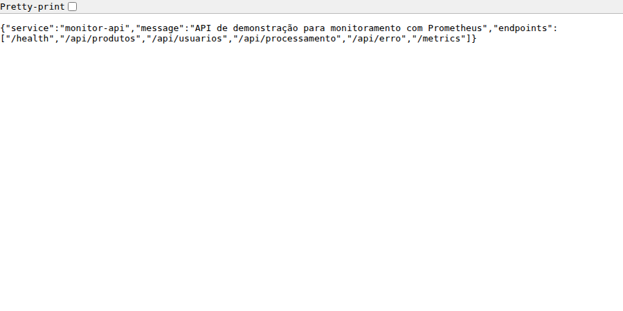

**Health check** — `http://localhost:3000/health`

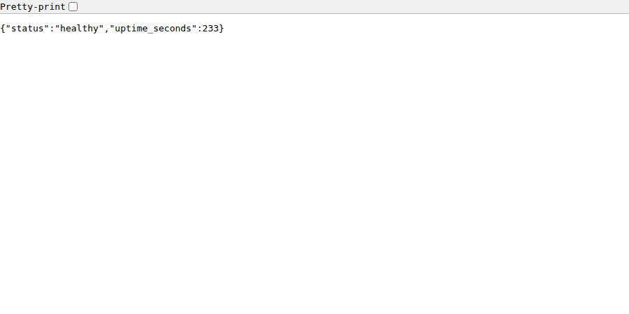

**Endpoint de produtos** — `http://localhost:3000/api/produtos`

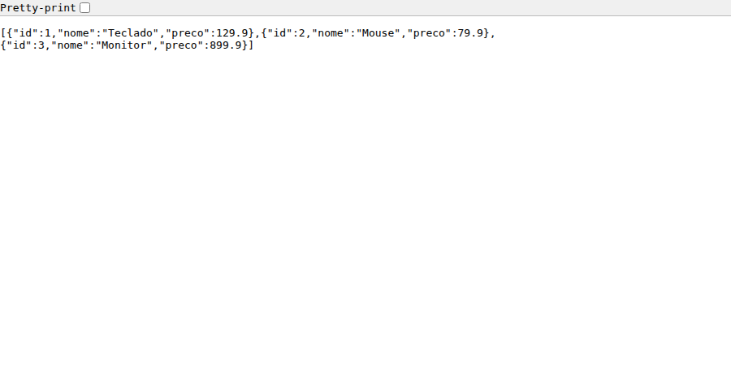

**Métricas expostas para o Prometheus** — `http://localhost:3000/metrics`

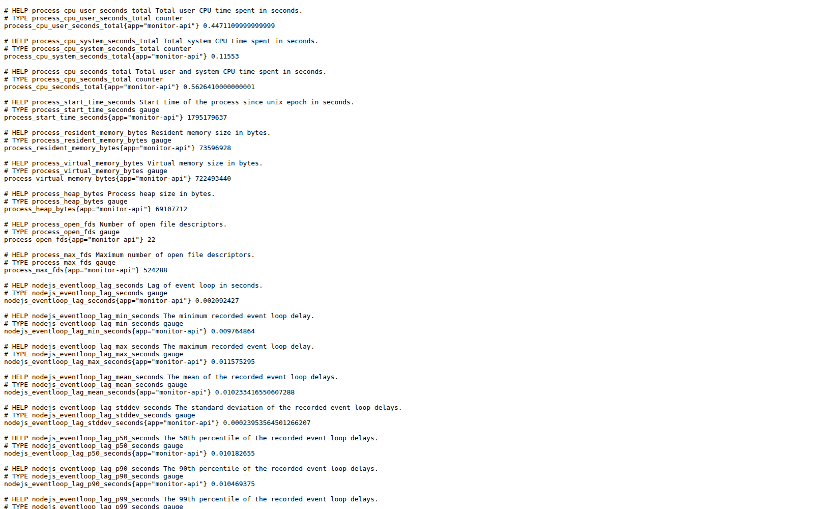

### Prometheus

**Targets com estado UP** (`monitor-api` e `prometheus`) — `http://localhost:9090/targets`

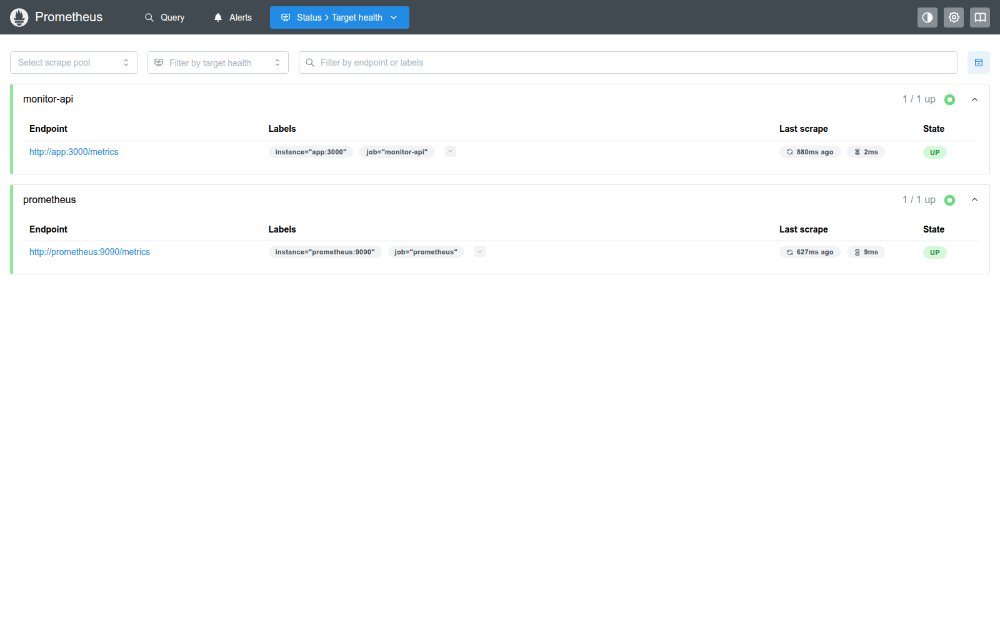

**Total de requisições por rota e status** — `sum by (route, status_code) (http_requests_total)`

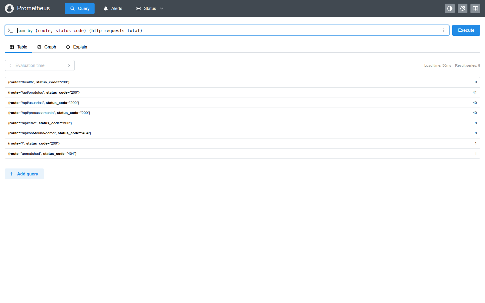

**Requisições por segundo** — `sum(rate(http_requests_total[1m]))`

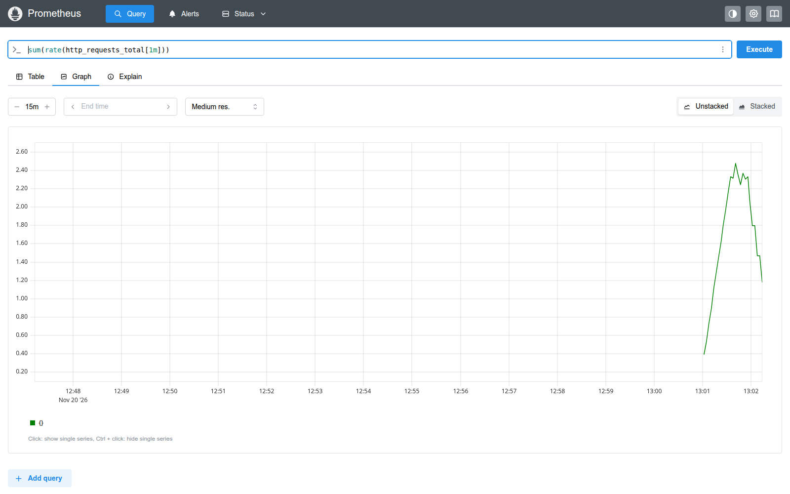

**Latência P95** — `histogram_quantile(0.95, sum by (le) (rate(http_request_duration_seconds_bucket[5m])))`

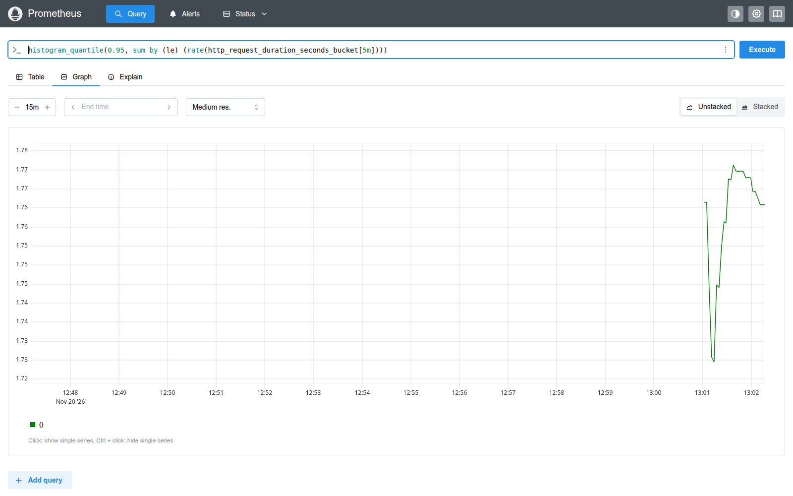

### Grafana

**Datasource Prometheus provisionado** — `http://localhost:3001/connections/datasources`

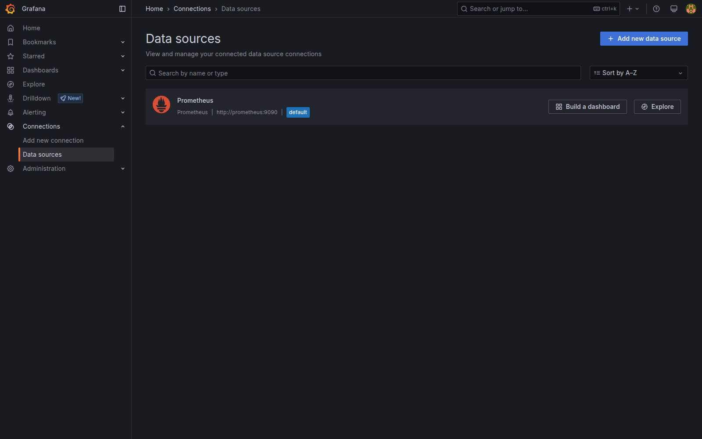

**Dashboard Monitor API - Prometheus Lab**

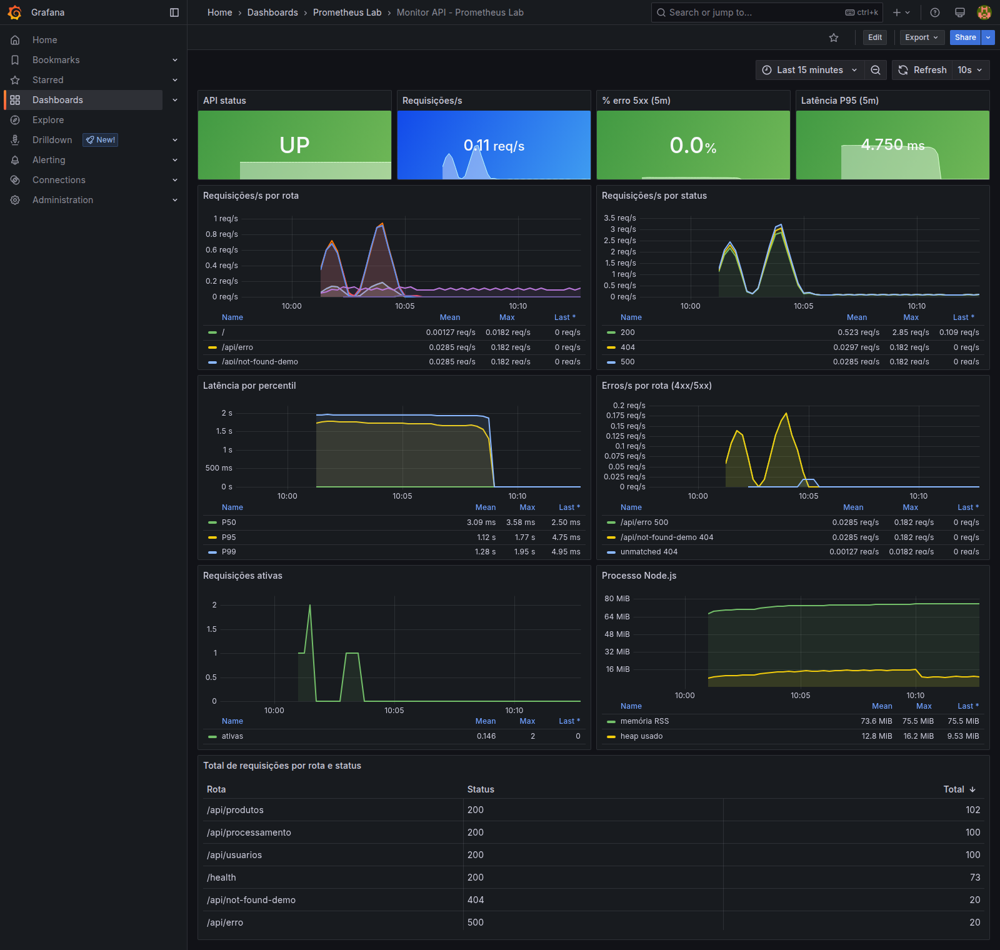

### Alerta no Telegram

**Notificação do alerta "API - Taxa de erro 5xx alta" enviada pelo Grafana ao bot do Telegram** — mensagem de disparo (**Firing**) e de resolução (**Resolved**).

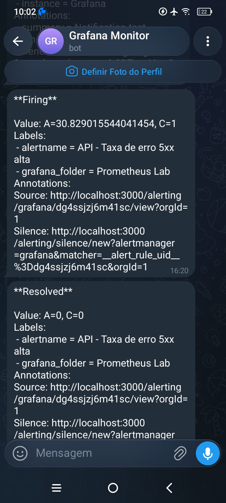
